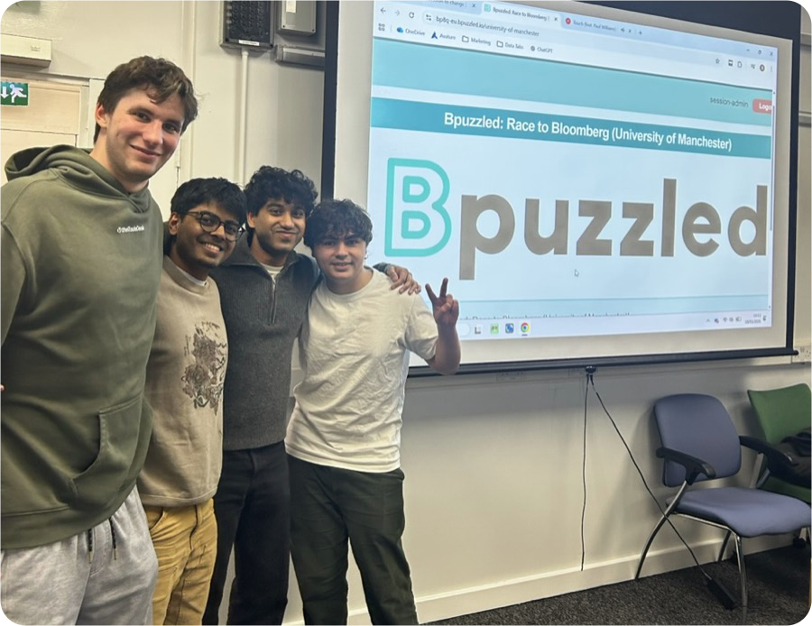
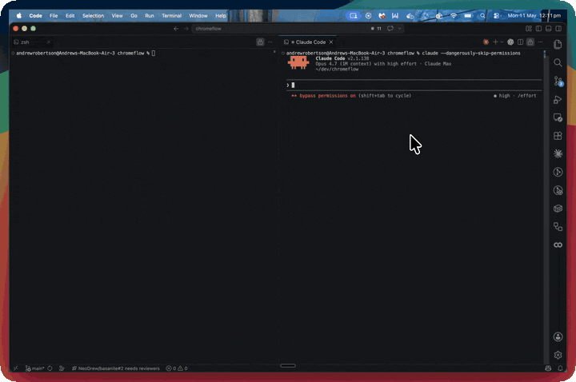
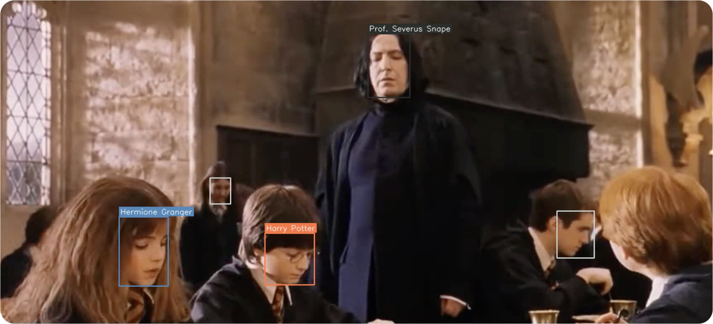
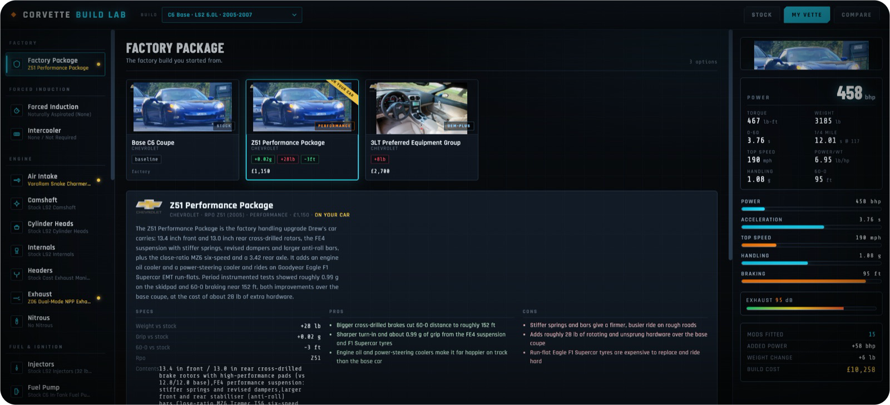

# Drew Robertson

CS @ University of Manchester

I build agent tooling: things that let AI coding agents do real work in the real world.

---

## 🏆 Hackathon wins

| | Event | Result | Project |
|---|---|---|---|
| 🥇 | **ICHack 2026** (Imperial, 700+ hackers) | **1st place, ElevenLabs track** · **1st place, JetBrains track** | [**911 Auto Call**](https://github.com/NeoDrew/911-auto-call): AI voice agents that answer 999/911 calls and run intake through to dispatch |
| 🥇 | **Bloomberg Bpuzzled 2025** (110 competitors) | **1st place** | Bloomberg's puzzle competition |
| 🏅 | **Great Uni Hack 2023** (Manchester, 50 teams) | **5th place** | [**Log-A-Log**](https://github.com/spudbracketspud/Log-A-Log): real time deforestation tracker; OpenCV foliage analysis over map tiles pinpoints the coordinates of logging |
| 🛠️ | **HackUPC 2026** (Barcelona) | Built for the Smadex sponsor challenge | [**Smadex Cooking**](https://github.com/NeoDrew/hackUPC): ad creative intelligence cockpit; fatigue classifier at 0.93 ROC AUC vs the dataset's 0.87 baseline |

   
  Bloomberg Bpuzzled, 1st place

---

## 🚀 Featured projects

### [chromeflow](https://github.com/NeoDrew/chromeflow) · [chromeflow.run](https://chromeflow.run)

Lets Claude Code and Codex CLI drive **your real Chrome**, with your logins, cookies and 2FA intact. Clicks, fills forms, grabs API keys and writes them to `.env`, and pauses for anything that needs a human.

- MCP server + Chrome extension, 30 browser tools
- Live on the [Chrome Web Store](https://chromewebstore.google.com/detail/chromeflow/lkdchdgkbkodliefobkkhiegjdiidime) and npm
- Shaped by 400+ hours of real agentic browser work: React Selects, shadow DOM, `isTrusted` gated forms, anti-bot clicks

  

 

  

<table>
<tr>
<td width="50%" valign="top">

### [telegram-claude-bot](https://github.com/NeoDrew/telegram-claude-bot)
A phone to Mac bridge for Claude Code. Message a Telegram bot and it relays into a **persistent Claude Code session** on your Mac, streaming the reply back live.

- Every chat is its own room with its own project directory, session, model and effort
- Cron style scheduled prompts, screenshots, per room user approval
- Parks itself on rate limits and resumes automatically when they clear

I run most of my life through it day to day.

  

</td>
<td width="50%" valign="top">

### [911 Auto Call](https://github.com/NeoDrew/911-auto-call) · 🥇 ICHack 2026
Autonomous ElevenLabs voice agents that answer emergency calls the instant they come in, triage the caller and run the call from intake to dispatch, so no 999/911 call ever waits in a queue. Trained on NHS ambulance call data. Won 1st place in both the ElevenLabs and JetBrains tracks.

   

</td>
</tr>
<tr>
<td width="50%" valign="top">

### [grad-job-hunt-engine](https://github.com/NeoDrew/grad-job-hunt-engine)
A discovery first job search system: sweeps ATS feeds, LinkedIn and Adzuna twice a day, scores every role against the candidate's CV, tracks the funnel, and drives ATS applications through chromeflow. **Got a real candidate placed.**

 

</td>
<td width="50%" valign="top">

### [hagrids-ml](https://github.com/NeoDrew/hagrids-ml)
Face detection and recognition over video: RetinaFace detection plus Facenet512 embeddings label every Harry Potter character in every frame.

 

</td>
</tr>
<tr>
<td colspan="2" valign="top">

### [Vette Build Lab](https://vette-customisation.vercel.app)
A Need for Speed: Carbon style configurator for my own C6 Corvette. All five C6 variants, 215 real parts with strict per engine fitment, bundled kits, live power/handling stats and a build advisor.

 

</td>
</tr>
</table>

<b>Older projects</b>

 

- [**Neo**](https://github.com/NeoDrew/Neo): a toy compiled programming language in C++
- [**dyad**](https://github.com/NeoDrew/dyad): stock viewing platform on Java Spring Boot
- [**ML-autocomplete**](https://github.com/NeoDrew/ML-autocomplete): next token autocomplete model
- [**AIHireMvp**](https://github.com/NeoDrew/AIHireMvp) / [**UI**](https://github.com/NeoDrew/AIHireMVP.UI): agentic candidate pipeline
- [**DBMS**](https://github.com/NeoDrew/DBMS): a small relational database management system
- [**mandelBrot**](https://github.com/NeoDrew/mandelBrot): JavaFX Mandelbrot set explorer

---

## 💼 Experience

| | |
|---|---|
| **The Trade Desk** · London | Software Engineer (2026 to now); SWE intern in 2025, GraphQL schema analysis service in .NET, shipped via Kubernetes and GitLab CI, return offer |
| **Record Asset Management** · London | Software Development Intern (2024 to 2025): internal trade comms system, 2850x cache speedup; C#, React, Azure, Terraform |
| **DataAnnotation** · remote | AI Engineer: top 10% performer across Java, C#, Python, F# |
| **Rothschild & Co** · London | Equity Research Insight (2024) |

---

## 🧰 Stack

 
more at <a href="https://drew.cash"><b>drew.cash</b></a>

